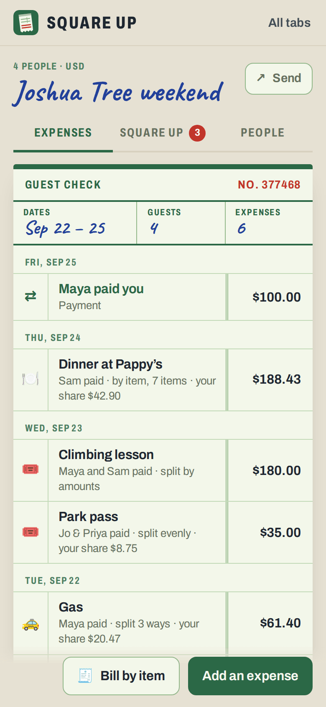
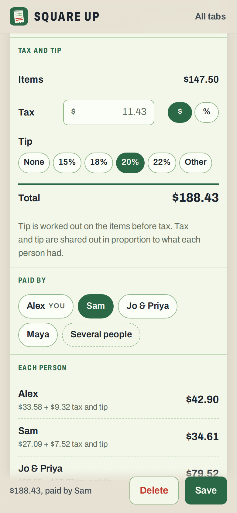
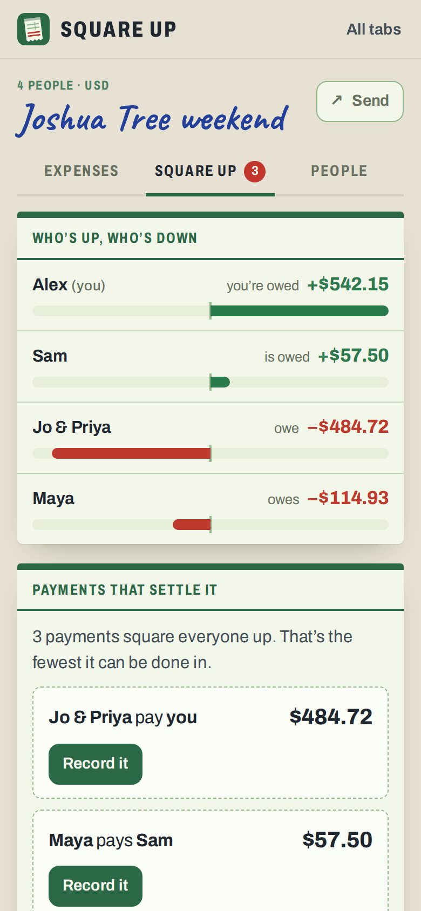
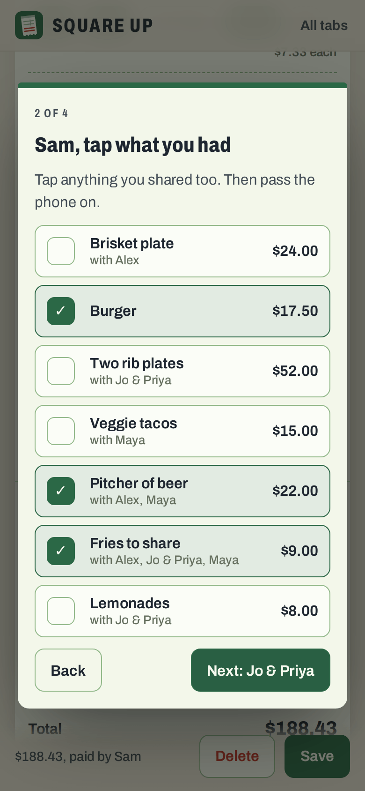
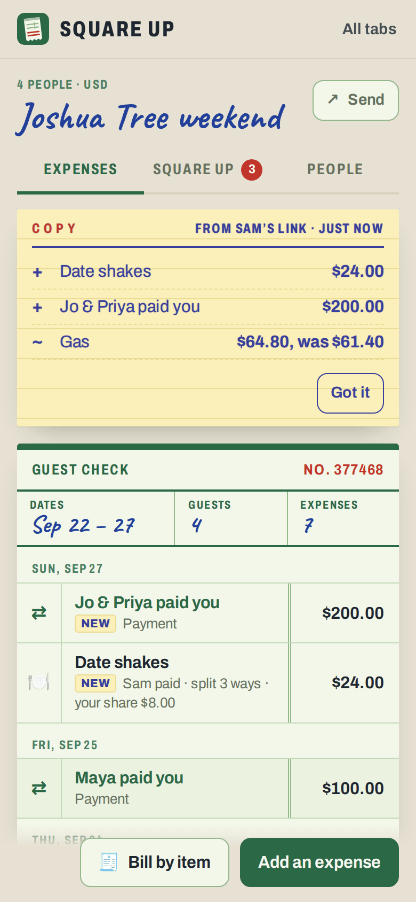

# Square Up

**Use it: [junkdrawer.works/square-up](https://junkdrawer.works/square-up/)**

**Split costs for a trip, a shared house or a dinner, and settle up in the fewest payments.** Keep a tab of what each person paid and who it was for: split equally, by shares, by exact amounts, by percent, or a restaurant bill by item with tax and tip. Square Up shows who's up, who's down, and the fewest payments that square everyone up. The tab travels between people as a link, with no accounts.

<p align="center">
  
  &nbsp;
  
  &nbsp;
  
</p>

<p align="center">
  
  &nbsp;
  
</p>

## How it works

- **A tab** is a trip, a house or a night out: the people on it and one currency. A couple or a family can go in as one person who counts as two when things are split by shares.
- **Add an expense:** what it was, how much, the date, a category and a note. **Paid by** one person, or several who each paid part. **Split** it equally between whoever's ticked, by shares, by exact amounts or by percent. Each person's part shows as you type, and it won't save until the parts add up. Amounts can be typed with a comma or a point, or as a sum like `6.50+4`.
- **Split a bill by item.** Type the items off the receipt, with Enter going from name to price to the next item, and tap who had each one. Or **go round the table**: pass the phone and each person taps what they had. Tax (an amount or a percent) and tip (15, 18, 20, 22% or your own, worked out on the items before tax) are shared in proportion to what each person had.
- **Every cent adds up.** Money is kept in whole cents, or whatever the currency's smallest unit is. When a split doesn't come out even, the leftover cents go to the parts that lost most in rounding, and on a tie the odd cent moves from person to person across expenses instead of always landing on the same one. Every expense adds up to its total exactly and everyone's balances add up to zero.
- **Square up** shows who's up and who's down, and the payments that settle it. Up to 15 people who are up or down, it finds the true fewest: a group whose balances cancel out can square up in one payment fewer than there are of them, so it looks through every subset for the most such groups. Beyond 15, whoever owes most pays whoever is owed most.
- **Record payments** as they happen ("Sam paid Alex $42.10"), whole or part, and the plan works out again from what's left. When everyone is square, it gets a stamp and can go in the archive. Give someone a Venmo username, a Cash App $cashtag or a PayPal.me name, and squaring up shows a button that opens the app with the amount filled in. Venmo only takes US dollars, and Cash App dollars and pounds.
- **Send the tab.** The whole tab goes in a link, squeezed small. Whoever opens it gets their own copy to add to, and sends a link back. Opening a link brings in what's new: people and expenses are matched by id and the copy that changed last wins, and deletions are remembered, so nothing is lost when two people add things at once. What came in shows on a yellow carbon copy (new, changed and deleted), and if your copy has things theirs didn't, it offers to send yours back. Or pass one phone round the table.
- **Several tabs**, a sample tab to try, and a tab can be saved as a spreadsheet.
- No account and no server. Your tabs stay in your browser, and links carry the tab after the #, which browsers don't send anywhere. Save a backup to a file and load it on another device; loading merges the same way links do. It works offline and installs to a phone's home screen.

## Running it

It's a static site: plain HTML, CSS and JavaScript modules, with no build step.

```sh
npx serve .                   # or any static file server, then open the printed address
npm install                   # only for the tools below: esbuild and upng-js
npm test                      # the arithmetic, settling up, merging and links (Node 20+), then the real page in Chromium (needs Playwright)
node tools/screenshots.mjs    # redraws docs/*.png and og.png
node tools/make-icons.mjs     # redraws the PNG icons from icon.svg
npm run build                 # dist/square-up.html, the whole app in one file, and dist/artifact.html
```

To put it online with GitHub Pages: **Settings → Pages → Build and deployment → Deploy from a branch**, then pick `main` and `/ (root)`.

### Files

- `js/money.js`: amounts in whole cents. Reading what people type, writing it back in their style, and splitting a total so the parts add up exactly.
- `js/model.js`: the tab, each kind of split, the bill by item, and what everyone paid, owes and is owed. No page code, so the tests run it in Node.
- `js/settle.js`: the fewest payments, and the Venmo, Cash App and PayPal links. `js/merge.js`: bringing two copies of a tab together.
- `js/share.js`: packs a tab into a link and reads one back, leaving out anything that doesn't add up.
- `js/app.js`: which screen goes with which address, the home screen, starting a tab and opening links. `js/tab.js`: the check, squaring up, the people and the sheets for sending and payments. `js/editor.js`: adding and changing an expense, the bill by item and going round the table.
- `js/ui.js`: pieces every screen uses. `js/store.js`: saving in the browser, and backups. `js/sample.js`: the sample tab.
- `fonts/`: Archivo and Caveat, both under the SIL Open Font License, served from here so nothing loads from elsewhere.
- `sw.js`: keeps a copy for using offline.
- `scripts/build.mjs`: the single-file copy. It follows a host's light or dark setting, hides backups and downloads when it's shown inside another page, and makes links that point at junkdrawer.works.
- `test/unit.test.mjs` checks the arithmetic across thousands of random tabs: every split adds up, balances add up to zero, settling up squares everyone, the fewest payments is never more than the quick rule and matches a brute-force search, merging in either order gives the same tab, and a tab comes out of a link exactly as it went in. `test/e2e.mjs` starts a tab, adds every kind of expense and a dinner by item, sends it to a second phone, adds something on each, merges the link back, squares up, and checks it works offline.
